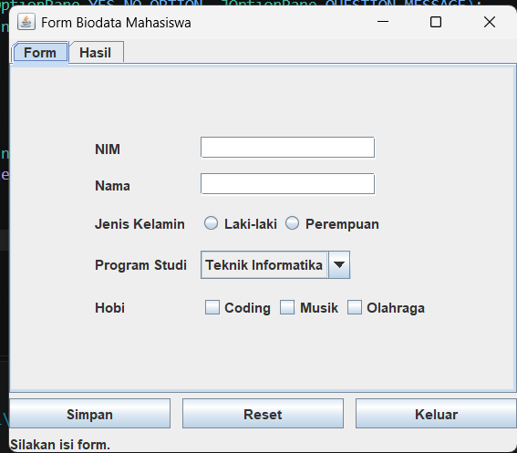
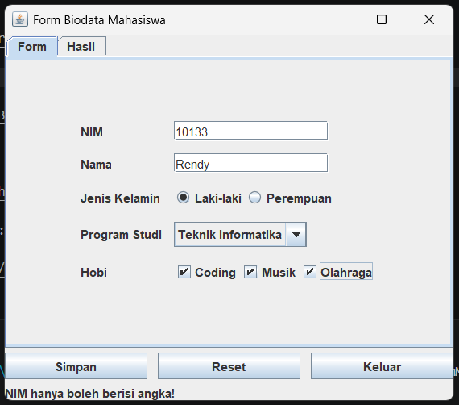
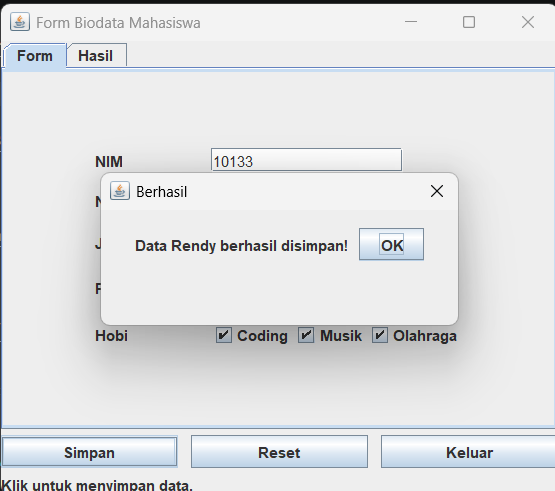
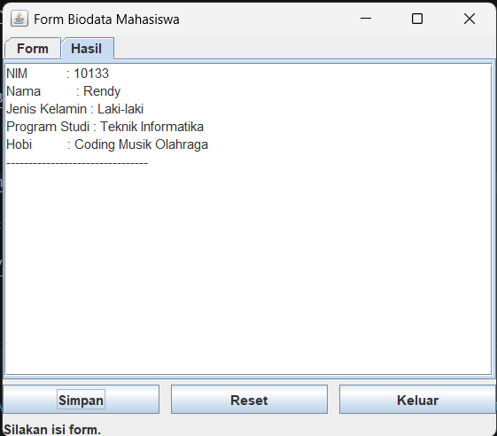
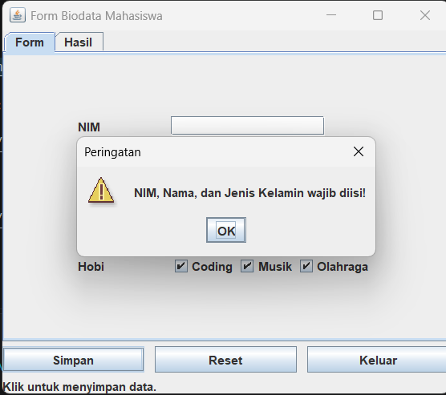
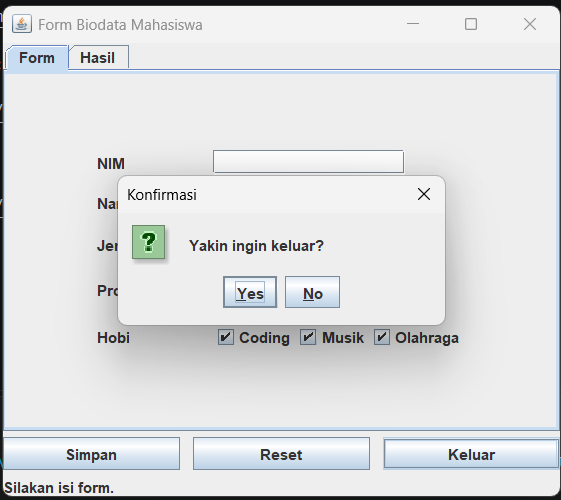

# Latihan/Eksplorasi GUI 5C - Form Biodata Mahasiswa

**Nama :** Rendy Wahyu Islami
**NIM  :** F1D02410133

Aplikasi GUI berbasis **Java Swing** berupa form biodata mahasiswa. Data yang diisi di tab **Form** akan ditampilkan di tab **Hasil**.

## Cara Menjalankan

```bash
javac FormMahasiswa.java
java FormMahasiswa
```

Membutuhkan JDK 8 atau lebih baru.

## Fitur

- Input NIM (hanya angka), nama, jenis kelamin, program studi, dan hobi
- Validasi: NIM, nama, dan jenis kelamin wajib diisi
- Data tersimpan ditampilkan di tab **Hasil**
- Tombol **Reset** mengosongkan form
- Konfirmasi saat keluar (tombol Keluar maupun tombol close X)

## 5 Komponen Utama GUI yang Digunakan

### 1. Top-level Container Class

| Class | Keterangan |
|---|---|
| `JFrame` | Jendela utama aplikasi. `FormMahasiswa` meng-extend `JFrame`. |
| `JDialog` | Dialog buatan sendiri (modal) yang muncul setelah data berhasil disimpan |
| `JOptionPane` | Dialog siap pakai untuk peringatan dan konfirmasi keluar |

### 2. Intermediate Container Class

| Class | Keterangan |
|---|---|
| `JPanel` | Mengelompokkan komponen (panel gender, panel hobi, panel tombol, panel bawah) |
| `JTabbedPane` | Membuat dua tab: **Form** dan **Hasil** |
| `JScrollPane` | Membungkus `JTextArea` agar bisa di-scroll |

### 3. Atomic Component Class

| Class | Fungsi |
|---|---|
| `JLabel` | Keterangan field dan label status |
| `JTextField` | Input NIM dan nama |
| `JRadioButton` + `ButtonGroup` | Memilih jenis kelamin (hanya satu pilihan) |
| `JComboBox` | Memilih program studi |
| `JCheckBox` | Memilih hobi (boleh lebih dari satu) |
| `JButton` | Tombol Simpan, Reset, Keluar, dan OK |
| `JTextArea` | Menampilkan hasil data yang tersimpan |

### 4. Layout Classes

| Class | Dipakai pada | Alasan |
|---|---|---|
| `BorderLayout` | Content pane `JFrame` dan panel bawah | Membagi area tengah (tab) dan bawah (tombol + status) |
| `GridBagLayout` | Panel form | Membuat form dua kolom (label dan input) yang rapi |
| `GridLayout` | Panel tombol (1 x 3) | Tiga tombol berukuran sama |
| `FlowLayout` | Panel gender, panel hobi, dan `JDialog` | Komponen tersusun berurutan dari kiri ke kanan |

### 5. Event Listener

| Interface / Adapter Class | Method yang di-override | Dipasang pada | Fungsi |
|---|---|---|---|
| `ActionListener` (interface) | `actionPerformed()` | Tombol Simpan, Reset, Keluar | Menjalankan aksi tombol |
| `KeyAdapter` (adapter class) | `keyTyped()` | `tfNim` | Menolak karakter selain angka pada NIM |
| `MouseAdapter` (adapter class) | `mouseEntered()`, `mouseExited()` | Tombol Simpan | Menampilkan petunjuk di label status |
| `WindowAdapter` (adapter class) | `windowClosing()` | `JFrame` | Menampilkan konfirmasi saat tombol close (X) ditekan |

## Screenshot

Tampilan awal (tab Form):



Form terisi:



Dialog berhasil disimpan:



Tab Hasil:



Dialog peringatan (field kosong):



Konfirmasi keluar:



## Struktur Repositori

```
.
├── FormMahasiswa.java
├── README.md
└── screenshots/
    ├── 01-tampilan-awal.png
    ├── 02-form-terisi.png
    ├── 03-dialog-berhasil.png
    ├── 04-tab-hasil.png
    ├── 05-dialog-peringatan.png
    └── 06-konfirmasi-keluar.png
```
